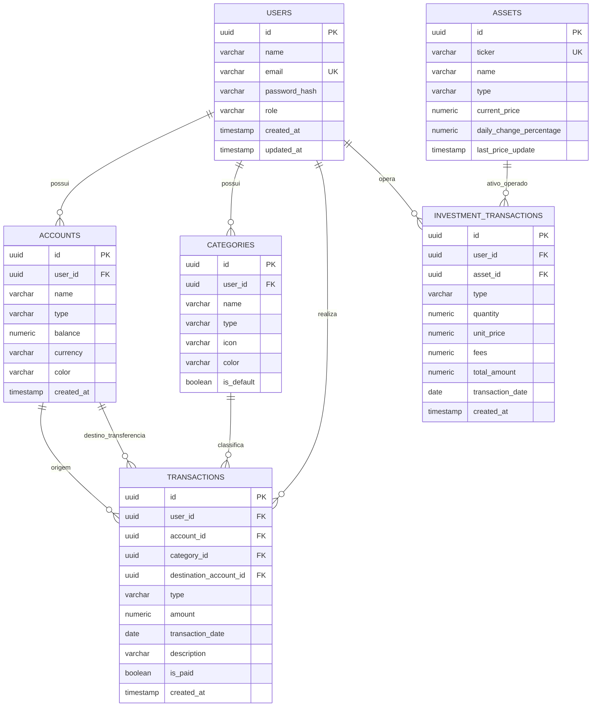

# Especificação Técnica do Sistema: Gestão Financeira Pessoal & Carteira de Investimentos

> **Documento Mestre de Arquitetura e Engenharia de Software**  
> Versão: 1.0.0 | Status: Aprovado para Desenvolvimento | Stack: Spring Boot + React TS + PostgreSQL + Brapi

---

## 1. Visão Geral do Produto

O sistema é uma plataforma completa e integrada para **Gestão de Finanças Pessoais e Acompanhamento de Investimentos da B3**, permitindo ao usuário:
1. Gerenciar múltiplas contas financeiras (corrente, poupança, investimento, dinheiro físico).
2. Lançar e categorizar receitas, despesas e transferências entre contas.
3. Cadastrar operações de compra e venda de ativos da bolsa (Ações, Fundos Imobiliários e ETFs).
4. Calcular de forma automatizada o **Preço Médio Ponderado (PM)**, **Patrimônio Investido**, **Valor Atual** e **Rentabilidade**.
5. Consultar cotações em tempo real da B3 via integração com a API **Brapi** (com fallback resiliente).
6. Acompanhar em um Dashboard unificado a evolução do **Patrimônio Total Líquido**, saldo disponível e fluxo de caixa mensal.

---

## 2. Arquitetura da Solução

```text
                                USUÁRIO
                                   │
                                   ▼
        ┌─────────────────────────────────────────────────────┐
        │                 FRONTEND (SPA)                      │
        │           React 18 + TypeScript + Vite              │
        │           Tailwind CSS + Lucide + Recharts          │
        │                   (Porta 5173)                      │
        └──────────────────────────┬──────────────────────────┘
                                   │ HTTPS / REST (JSON + JWT)
                                   ▼
        ┌─────────────────────────────────────────────────────┐
        │                BACKEND (REST API)                   │
        │        Spring Boot 3.4+ / Java 21+ LTS              │
        │    Spring Security (JWT Stateless) + Data JPA       │
        │                   (Porta 8080)                      │
        └──────────────┬──────────────────────┬───────────────┘
                       │                      │
                       ▼                      ▼
        ┌────────────────────────┐  ┌─────────────────────────┐
        │   PostgreSQL 16        │  │     Brapi API (B3)      │
        │   `gestao_financeira`  │  │   https://brapi.dev     │
        │       Porta 5432       │  │ (Cotações com Fallback) │
        └────────────────────────┘  └─────────────────────────┘
```

---

## 3. Modelo de Dados Relacional (PostgreSQL)

### 3.1 Diagrama Entidade-Relacionamento (ERD)



### 3.2 Dicionário de Tabelas

1. **`users`**:
   - `id`: UUID (Primary Key)
   - `name`: VARCHAR(120) NOT NULL
   - `email`: VARCHAR(150) NOT NULL UNIQUE
   - `password_hash`: VARCHAR(255) NOT NULL (BCrypt)
   - `role`: VARCHAR(20) NOT NULL DEFAULT 'ROLE_USER'
   - `created_at`: TIMESTAMP WITH TIME ZONE DEFAULT NOW()
   - `updated_at`: TIMESTAMP WITH TIME ZONE DEFAULT NOW()

2. **`accounts`**:
   - `id`: UUID (Primary Key)
   - `user_id`: UUID NOT NULL REFERENCES users(id) ON DELETE CASCADE
   - `name`: VARCHAR(80) NOT NULL (Ex: 'Nubank', 'Itaú Corrente', 'Carteira')
   - `type`: VARCHAR(30) NOT NULL (CHECKING, SAVINGS, INVESTMENT, CASH)
   - `balance`: NUMERIC(15, 2) NOT NULL DEFAULT 0.00
   - `currency`: VARCHAR(5) NOT NULL DEFAULT 'BRL'
   - `color`: VARCHAR(20) DEFAULT '#3B82F6'
   - `created_at`: TIMESTAMP WITH TIME ZONE DEFAULT NOW()

3. **`categories`**:
   - `id`: UUID (Primary Key)
   - `user_id`: UUID NULL REFERENCES users(id) ON DELETE CASCADE (NULL = categoria global do sistema)
   - `name`: VARCHAR(60) NOT NULL (Ex: 'Salário', 'Alimentação', 'Moradia', 'Investimentos')
   - `type`: VARCHAR(20) NOT NULL (INCOME, EXPENSE)
   - `icon`: VARCHAR(40) DEFAULT 'tag'
   - `color`: VARCHAR(20) DEFAULT '#10B981'
   - `is_default`: BOOLEAN DEFAULT FALSE

4. **`transactions`**:
   - `id`: UUID (Primary Key)
   - `user_id`: UUID NOT NULL REFERENCES users(id) ON DELETE CASCADE
   - `account_id`: UUID NOT NULL REFERENCES accounts(id) ON DELETE CASCADE
   - `category_id`: UUID NULL REFERENCES categories(id) ON DELETE SET NULL
   - `destination_account_id`: UUID NULL REFERENCES accounts(id) ON DELETE SET NULL (usado em TRANSFER)
   - `type`: VARCHAR(20) NOT NULL (INCOME, EXPENSE, TRANSFER)
   - `amount`: NUMERIC(15, 2) NOT NULL CHECK (amount > 0)
   - `transaction_date`: DATE NOT NULL
   - `description`: VARCHAR(200) NOT NULL
   - `is_paid`: BOOLEAN NOT NULL DEFAULT TRUE
   - `created_at`: TIMESTAMP WITH TIME ZONE DEFAULT NOW()

5. **`assets`**:
   - `id`: UUID (Primary Key)
   - `ticker`: VARCHAR(12) NOT NULL UNIQUE (Ex: 'PETR4', 'VALE3', 'MXRF11', 'IVVB11')
   - `name`: VARCHAR(120) NOT NULL
   - `type`: VARCHAR(20) NOT NULL (STOCK, FII, ETF, BDR)
   - `current_price`: NUMERIC(15, 4) NOT NULL DEFAULT 0.0000
   - `daily_change_percentage`: NUMERIC(8, 4) DEFAULT 0.0000
   - `last_price_update`: TIMESTAMP WITH TIME ZONE DEFAULT NOW()

6. **`investment_transactions`**:
   - `id`: UUID (Primary Key)
   - `user_id`: UUID NOT NULL REFERENCES users(id) ON DELETE CASCADE
   - `asset_id`: UUID NOT NULL REFERENCES assets(id) ON DELETE RESTRICT
   - `type`: VARCHAR(10) NOT NULL (BUY, SELL)
   - `quantity`: NUMERIC(15, 4) NOT NULL CHECK (quantity > 0)
   - `unit_price`: NUMERIC(15, 4) NOT NULL CHECK (unit_price > 0)
   - `fees`: NUMERIC(15, 2) NOT NULL DEFAULT 0.00 CHECK (fees >= 0)
   - `total_amount`: NUMERIC(15, 2) NOT NULL
   - `transaction_date`: DATE NOT NULL
   - `created_at`: TIMESTAMP WITH TIME ZONE DEFAULT NOW()

---

## 4. Regras de Negócio e Cálculos Financeiros

### 4.1 Gestão de Saldos Bancários
- Ao salvar uma transação `INCOME` (Receita) com `is_paid = true`:
  $$\Delta Saldo = +Valor$$
- Ao salvar uma transação `EXPENSE` (Despesa) com `is_paid = true`:
  $$\Delta Saldo = -Valor$$
- Ao salvar uma transação `TRANSFER` (Transferência):
  $$\Delta Saldo_{Origem} = -Valor$$
  $$\Delta Saldo_{Destino} = +Valor$$
- Edições ou exclusões de transações revertem proporcionalmente o impacto financeiro na respectiva conta.

### 4.2 Preço Médio Ponderado (PM) de Investimentos
O Preço Médio Ponderado segue o padrão da Receita Federal e B3:
- **Na COMPRA (BUY)**:
  $$Q_{nova} = Q_{ant} + Q_{compra}$$
  $$CustoTotal_{novo} = (Q_{ant} \times PM_{ant}) + (Q_{compra} \times Preço_{compra}) + Taxas$$
  $$PM_{novo} = \frac{CustoTotal_{novo}}{Q_{nova}}$$

- **Na VENDA (SELL)**:
  - O Preço Médio **NÃO** se altera na venda parcial.
  - A quantidade em carteira é reduzida: $Q_{nova} = Q_{ant} - Q_{venda}$.
  - O lucro/prejuízo realizado é apurado:
    $$ResultadoRealizado = (Preço_{venda} - PM_{ant}) \times Q_{venda} - Taxas$$
  - Validação estrita: O usuário não pode vender mais quantidade do que possui em custódia.

### 4.3 Posição Consolidada e Rentabilidade
Para cada ativo na carteira do usuário com $Q > 0$:
- **Valor Atual (Patrimônio de Mercado)**:
  $$ValorAtual = Q \times CotaçãoAtual$$
- **Total Investido (Custo de Aquisição)**:
  $$CustoInvestido = Q \times PM$$
- **Lucro / Prejuízo Não Realizado**:
  $$Resultado = ValorAtual - CustoInvestido$$
- **Rentabilidade Percentual**:
  $$Rentabilidade\% = \left(\frac{Resultado}{CustoInvestido}\right) \times 100$$

### 4.4 Dashboard e Patrimônio Consolidado
- **Saldo Disponível em Contas**: $\sum Saldo(Contas)$
- **Patrimônio em Investimentos**: $\sum ValorAtual(Posições)$
- **Patrimônio Total Líquido**:
  $$PatrimônioTotal = SaldoDisponível + PatrimônioInvestimentos$$
- **Fluxo Mensal**:
  $$ReceitasMês = \sum Transações(INCOME, Mês)$$
  $$DespesasMês = \sum Transações(EXPENSE, Mês)$$
  $$ResultadoMês = ReceitasMês - DespesasMês$$

---

## 5. Integração com API de Mercado (Brapi & Fallback)

### 5.1 Endpoint Brapi
- URL Base: `https://brapi.dev/api/quote/{tickers}`
- Exemplo de resposta consumida:
```json
{
  "results": [
    {
      "symbol": "PETR4",
      "shortName": "PETROBRAS PN",
      "regularMarketPrice": 38.45,
      "regularMarketChangePercent": 1.25,
      "regularMarketTime": "2026-09-22T20:00:00.000Z"
    }
  ]
}
```

### 5.2 Estratégia de Resiliência e Fallback
1. **Cache local**: Ao consultar cotações, o sistema armazena a cotação e o timestamp em `assets`. Se a última atualização tiver menos de 15 minutos, reutiliza o valor em cache.
2. **Fallback Simulado**: Se a Brapi estiver fora do ar ou atingir rate limit, o serviço captura a exceção, utiliza o último preço conhecido registrado no banco de dados e, para novos ativos sem histórico, gera uma cotação simulada realista com base na variação diária de mercado, registrando em log.

---

## 6. Especificação dos Endpoints REST (OpenAPI)

| Módulo | Método | Rota | Descrição | Auth |
|---|---|---|---|---|
| **Auth** | `POST` | `/api/auth/register` | Cadastro de novo usuário | Pública |
| **Auth** | `POST` | `/api/auth/login` | Login e emissão de JWT Token | Pública |
| **Auth** | `GET` | `/api/auth/me` | Dados do usuário autenticado | Bearer |
| **Accounts** | `GET` | `/api/accounts` | Lista contas com saldos | Bearer |
| **Accounts** | `POST` | `/api/accounts` | Criação de nova conta | Bearer |
| **Accounts** | `PUT` | `/api/accounts/{id}` | Atualização de dados da conta | Bearer |
| **Accounts** | `DELETE` | `/api/accounts/{id}` | Exclusão de conta | Bearer |
| **Categories** | `GET` | `/api/categories` | Lista categorias (padrão + usuário) | Bearer |
| **Categories** | `POST` | `/api/categories` | Criação de categoria personalizada | Bearer |
| **Transactions**| `GET` | `/api/transactions` | Filtro por mês/ano, tipo, conta | Bearer |
| **Transactions**| `POST` | `/api/transactions` | Criação de receita/despesa/transferência | Bearer |
| **Transactions**| `PUT` | `/api/transactions/{id}` | Atualização de transação | Bearer |
| **Transactions**| `DELETE` | `/api/transactions/{id}` | Exclusão e reversão de saldo | Bearer |
| **Investments** | `GET` | `/api/investments/positions` | Carteira consolidada com PM e yield | Bearer |
| **Investments** | `GET` | `/api/investments/transactions` | Histórico de ordens de compra/venda | Bearer |
| **Investments** | `POST` | `/api/investments/transactions` | Registrar compra ou venda de ativo | Bearer |
| **Market** | `GET` | `/api/market/quote/{ticker}` | Consulta cotação atual na B3 | Bearer |
| **Market** | `POST` | `/api/market/sync` | Força sincronização de cotações | Bearer |
| **Dashboard** | `GET` | `/api/dashboard/summary` | Cards de patrimônio, saldo e fluxo | Bearer |
| **Dashboard** | `GET` | `/api/dashboard/evolution` | Dados para gráficos de evolução | Bearer |

---

## 7. Estrutura de Diretórios do Projeto

```text
API de Gestão Financeira/
├── SPEC_GESTAO_FINANCEIRA.md
├── docker-compose.yml
├── backend/
│   ├── mvnw
│   ├── mvnw.cmd
│   ├── pom.xml
│   └── src/
│       ├── main/
│       │   ├── java/com/gestaofinanceira/
│       │   │   ├── Application.java
│       │   │   ├── config/
│       │   │   ├── security/
│       │   │   ├── modules/
│       │   │   │   ├── auth/
│       │   │   │   ├── user/
│       │   │   │   ├── account/
│       │   │   │   ├── category/
│       │   │   │   ├── transaction/
│       │   │   │   ├── investment/
│       │   │   │   ├── market/
│       │   │   │   └── dashboard/
│       │   │   └── shared/
│       │   └── resources/
│       │       └── application.yml
│       └── test/
└── frontend/
    ├── package.json
    ├── vite.config.ts
    ├── tailwind.config.js
    ├── index.html
    └── src/
        ├── App.tsx
        ├── main.tsx
        ├── components/
        ├── contexts/
        ├── hooks/
        ├── pages/
        ├── services/
        └── types/
```

---

## 8. Critérios de Aceite e Testes

1. **Autenticação**:
   - Registro de usuário com validação de e-mail e senha mínima de 6 caracteres.
   - Login emitindo token JWT válido com expiração de 24 horas.
2. **Finanças Pessoais**:
   - Criar conta bancária e realizar lançamentos de receitas e despesas com atualização atômica e correta do saldo.
   - Reversão correta de saldos caso uma transação seja editada ou excluída.
3. **Investimentos e Mercado**:
   - Ao comprar 100 cotas de `PETR4` a R$ 35,00 e depois 100 cotas a R$ 40,00, o Preço Médio deve ser exatamente R$ 37,50.
   - Ao consultar cotação externa de R$ 39,00, a rentabilidade percentual calculada deve ser de $+4,00\%$.
   - Não permitir venda com quantidade superior à quantidade em custódia.
4. **Dashboard**:
   - Exibir patrimônio total como a soma exata dos saldos em conta mais o valor a mercado dos investimentos.
   - Apresentar gráfico visual de evolução patrimonial e alocação da carteira.
